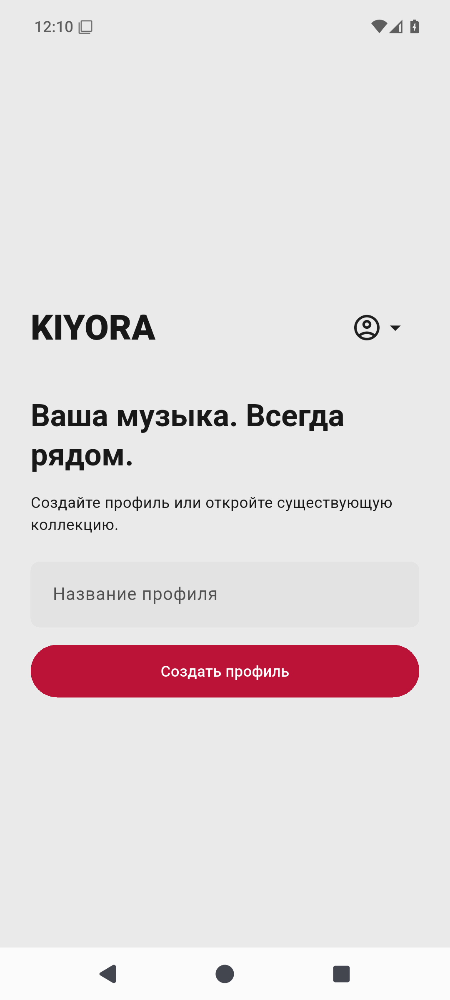
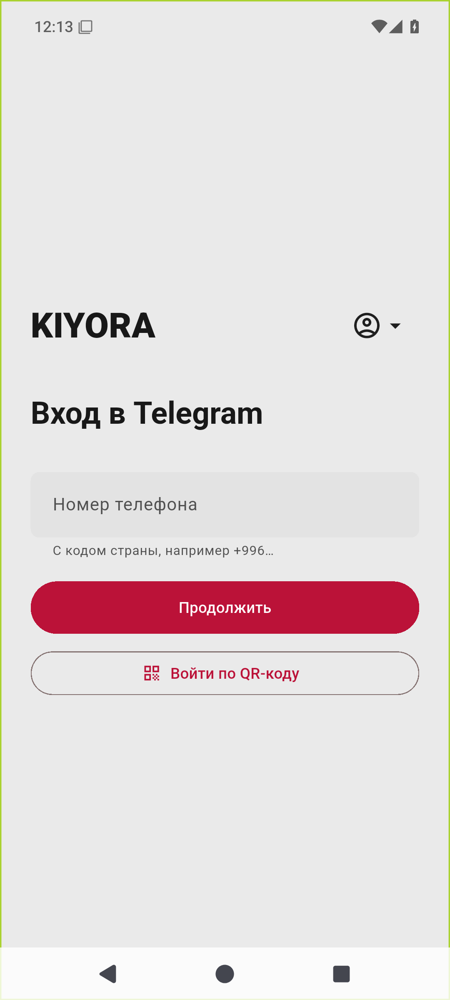
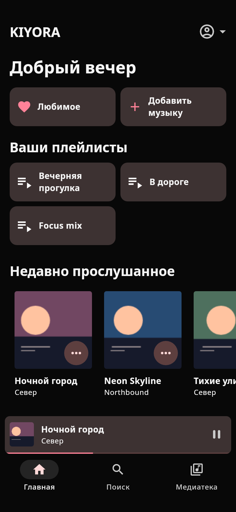
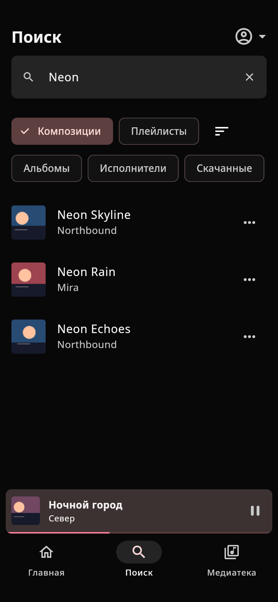
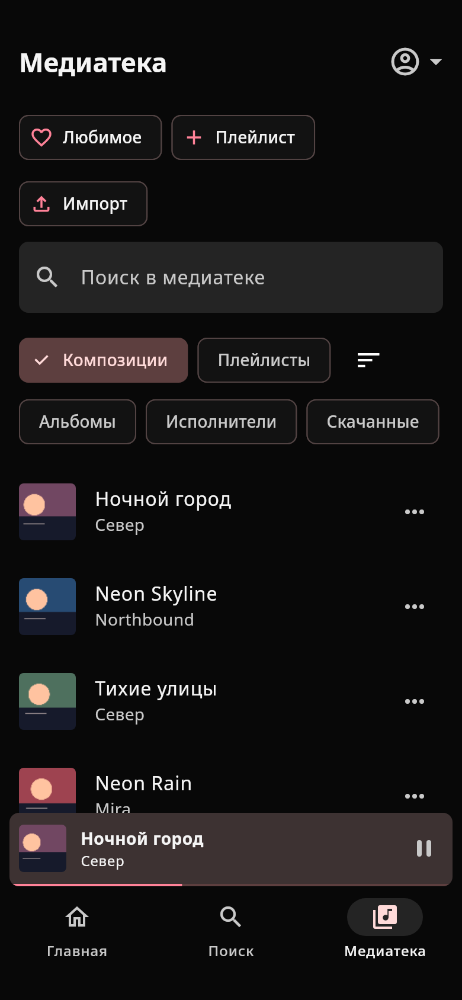
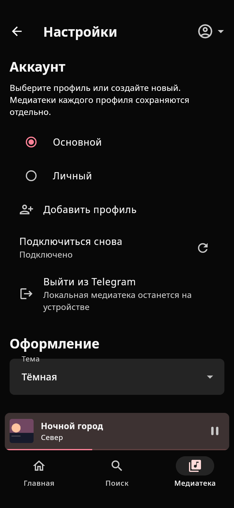

# Android verification — 29 November 2026

This report records tests that actually ran against the working tree and an
Android emulator. It distinguishes on-device screens from synthetic Flutter
widget screenshots. No personal Telegram account or music collection was used.

## Builds and environment

- Checkout: `master` (Android packaging fix `b7dcd4a` and WakeLock fix
  `c7812a1`).
- Build host: CachyOS Linux x86_64, Flutter 3.50.0, Android SDK 36,
  NDK 28.2.13676358, JDK 21.
- Emulator: isolated `Kiyora_QA_API35` AVD, Android 15 / API 35,
  x86_64, KVM acceleration, **4 KiB kernel page size**.
- Installable debug APK: `flutter/build/app/outputs/flutter-apk/kiyora-arm64-debug.apk`
  (ARM64), and `kiyora-x86_64-debug.apk` (emulator x86_64).
- Release-format AAB: `flutter/build/app/outputs/bundle/release/app-release.aab`
  (ARM64 + x86_64); the release signing configuration was **not present**
  on this build host. This AAB must be signed for distribution.

The two debug APKs passed `apksigner verify`, `zipalign -c -P 16 -v 4`,
and `verify_android_package.py` with no unexpected ABI and with 16 KiB
ELF LOAD alignment in the packaged native libraries. The AAB passed the
dual-ABI ELF/package verifier. ELF alignment is not equivalent to a test
on a device running 16 KiB pages.

## Automated checks

| Check | Observed result |
| --- | --- |
| `flutter analyze --no-pub` | PASS, no issues |
| `flutter test --no-pub` | PASS, 99 tests; opt-in screenshot test skipped |
| `cargo test --workspace --locked --offline --jobs 2` | PASS, 237; 2 ignored |
| `python3 -m unittest discover -s flutter/tool -p test_android_package.py` | PASS, 2 tests |
| `python3 flutter/tool/test_native.py` | PASS, isolated Rust bridge seed/restore |
| `python3 flutter/tool/test_auth.py` | PASS, isolated TDLib/Secret Service create, missing keyring, restore |
| `flutter build apk --debug`, ARM64 and x86_64 | PASS, separately verified |
| `flutter build appbundle --release`, both ABIs | PASS, native package verified; distribution signing pending |

Existing Linux real-audio/MPRIS and host screenshots were tested on
28 November; see [Android build and testing](ANDROID_BUILD_AND_TESTING.md)
and [Linux testing](FLUTTER_LINUX_TESTING.md). They were not rerun as
Android system audio tests on 29 November.

## Real emulator acceptance

| Test | Result and scope |
| --- | --- |
| `adb install -r` of the x86_64 APK | PASS, installation succeeded |
| Start `io.github.arkfarin.kiyora/.MainActivity` | PASS, Activity resumed and process alive |
| First-run onboarding, Russian text, touch controls | PASS, visually inspected real Android screenshot |
| Create disposable local profile `KIYORA_QA` | PASS, advanced to Telegram connection |
| Force-stop and relaunch | PASS, saved profile was restored and login step remained available |
| Tap Telegram connect | PASS, phone entry and QR alternative rendered from the native authorization flow |
| AndroidRuntime/flutter error-tag scan during those steps | No matching fatal error entries in the captured logcat snapshot |

No phone number, one-time code, QR authorization, Telegram vault, or personal
music was used. Therefore a visible login entry screen does **not** establish
completed Telegram authorization, 2FA, sync, or authenticated playback.

## Screenshots

**Actual Android emulator:** captured using `adb exec-out screencap -p`
from an installed x86_64 debug APK.

<p>
  
  
  
</p>

**Flutter widget-render screenshots:** produced by the opt-in test fixture
with explicitly synthetic songs, albums and artwork. These demonstrate layout
but are *not* Android device evidence and contain no production recommendations.

<p>
  
  
  
  
  
</p>

## Reproduce the emulator acceptance

The APK must be built for the emulator ABI. From the repository root:

```sh
export JAVA_HOME="$HOME/.local/share/kiyora-sdk/jdk21-unpacked/usr/lib/jvm/java-21-openjdk"
export PATH="$HOME/.local/share/kiyora-sdk/flutter-3.50.0/bin:$JAVA_HOME/bin:$PATH"
export KIYORA_ANDROID_ABIS=x86_64
bash flutter/tool/package_android.sh --debug
adb devices -l
adb install -r flutter/build/app/outputs/flutter-apk/app-debug.apk
adb shell am start -n io.github.arkfarin.kiyora/.MainActivity
adb exec-out screencap -p > android-kiyora-start.png
```

To reproduce with an existing debug APK, run just the `adb` commands above
and substitute `kiyora-x86_64-debug.apk` as the install path.
The QA AVD created on this host was named `Kiyora_QA_API35`; it is isolated
from any pre-existing user emulators.

## Outstanding acceptance and release requirements

- Real authenticated Telegram sign-in (phone, QR and 2FA), existing-vault
  recovery, sync, offline cache, imported files and profile transitions.
- Actual remote/local audio output, long-running playback while locked, live
  foreground notification, MediaSession, Bluetooth, Audio Focus and call
  interruption behavior. Kotlin implementation exists but was not proved with
  authenticated media in this session.
- Real 16 KiB-page Android device/emulator and Android 8.0 device testing.
- Physical POCO/Xiaomi background and vendor battery behavior, large-library
  frame-time/memory/battery measurements, long-term stability.
- A configured private release signing key, a signed release artifact, and a
  tested signing/update path. Debug APKs are intended only for development.
- Full-download-before-play preference remains unimplemented; offline caching
  and pinning are separate existing functions.

These gaps prevent an assertion that the Android app is ready for everyday
production use. The verified scope here is native packaging, host regressions,
and a real-device-style emulator onboarding smoke test.
